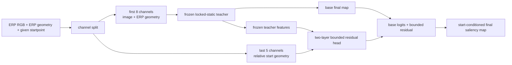
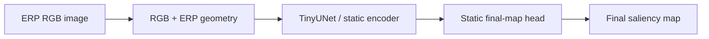
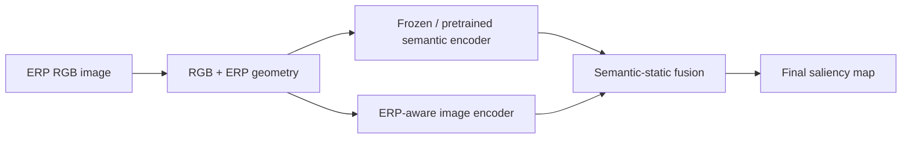
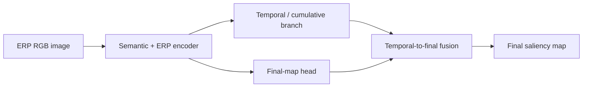
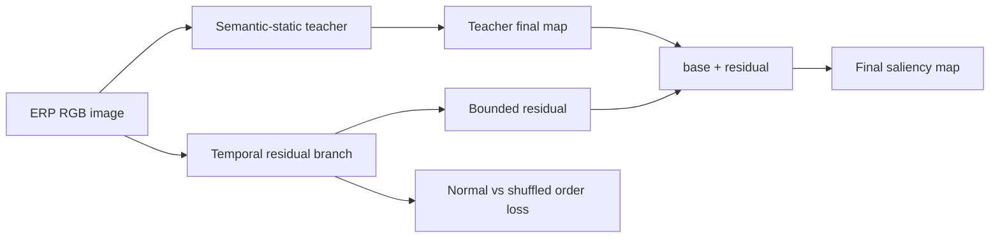
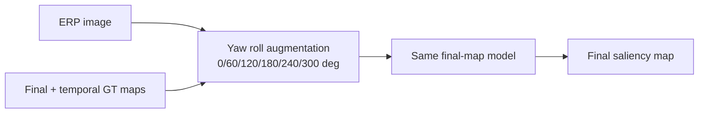
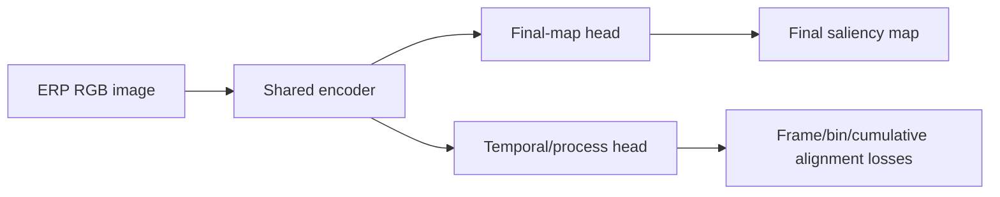
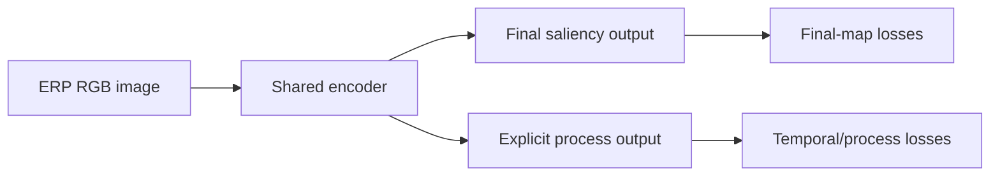
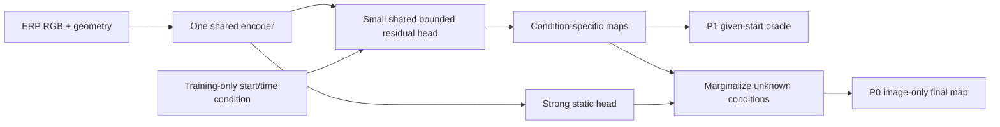

# SphereRate Mainline Model Versions

更新时间：2026-08-06

> **Protocol lock:** [RESEARCH_PROTOCOL.md](RESEARCH_PROTOCOL.md) is authoritative. Since 2026-08-05 the paper benchmark uses a conventional content-disjoint `59 train / 13 val / 13 test` split: train fits parameters, val selects checkpoints, and test is repeatedly evaluable but never used for selection. Earlier `50/9/13/13` results are historical.

当前交付状态与 Cov.@5/10/15/20、5 s 目标见 [Goal.md](Goal.md)、[标准 validation](reports/standard_split_primary_val/summary.md)、[标准 test](reports/standard_split_primary_test/summary.md) 与 [完整 benchmark](reports/standard_split_full_benchmark_test/summary.md)。本文件下方的 V0--V11 路线仅用于解释历史决策；其大体量可视化/预测缓存已于 2026-07-15 清理，不再保证历史链接可直接打开。

当前执行状态（kernel-corrected）：

```text
R1/P2 FAIL
-> SA-EHS v1 EH0–EH6 historical-only (wrong 10 px ERP kernel)
-> K0 kernel audit PASS
-> K1 spherical 2° v2 data PASS
-> K2 matched retraining + K3 Salient360 three-seed validation PASS
-> K3 ET-DK2 template-improvement guard FAIL (point positive, CI crosses 0)
-> K4 v2 matched-baseline benchmark PASS (development val/gate; zero v2-test access)
-> K5 official Sitzmann re-entry PASS; Salient360 remains primary training source
-> K6 full Sitzmann-only + bidirectional frozen transfer PASS; Sitzmann is secondary in-domain track
-> S0 semantic oracle PASS; S1/S2 joint KLD+Cov5+Cov10 gate FAIL
-> V11-A–F targeted loss/head branches FAIL or PARTIAL
-> V11-G TempSAL prior adapter: all six val/gate means improve; innovation insufficient
-> V12-A isotropic dwell-rate: density/5 s improve, Cov5 fails
-> V12-B train-only anisotropic calibration: early Cov5 nearly repaired, late cost too restrictive
-> V12-C early-anisotropic/late-semantic dwell-rate: val all means improve; frozen gate only early Cov5 remains below TempSAL
-> V12-X frozen transfer: Sitzmann/ET-DK2 overall TempSAL dominance FAIL; start dynamics transfer better than content reranking
-> V3 standard 59/13/13 rerun COMPLETE; all matched baselines use val selection and unchanged test reporting
-> V12-C is current standalone mainline candidate; test density + Cov10/15/20 lead, Cov5 remains tied/slightly lower
-> V12-S Sitzmann-only 16/3/3: Coverage improves over TempSAL, early density does not; cross-dataset matrix retired from active comparison
-> V12-R reviewer closure: real native-resolution HEVC application + matched rate/start/tile-loss ablation COMPLETE
-> Start cost is decisive; accumulation helps density/Cov10/20; tile loss is a minor regularizer; real-byte 5% remains a confirmed failure
```

这个文件是工作区根目录的主线索引。打开它应该能直接看到：

- 当前 final-map 主线框架是什么。
- 每个已跑版本的框架差异。
- 关键性能结果。
- 对应可视化入口。
- 哪些版本有效、哪些只是负控或诊断。

主线约束：**inference 只允许 ERP RGB、ERP geometry、系统声明的 equatorial initial yaw 和 horizon；不允许 GT prefix、GT first fixation、GT scanpath 或 observer identity。Test 可重复评估，但禁止据其选择 checkpoint、结构或超参数。**

例外但必须单独汇报：JUFE start-conditioned protocol 可以输入数据集给定的 startpoint metadata，用于预测 start-conditioned final saliency map；它不是 image-only 主线结果。

Off-mainline next-fixation / start-only / dual-path 的大体量归档已于 2026-07-15 清理；冻结结论保留在研究协议和版本索引中，不得恢复为主线。

## Current Mainline Status

```mermaid
flowchart LR
  input["ERP RGB + geometry + declared yaw + t"] --> align["Align start to canonical ERP reference"]
  align --> visual["Shared semantic trunk"]
  visual --> utility["Semantic utility − spherical gaze cost"]
  utility --> rate["Non-negative interval dwell rates"]
  rate --> maps["Raw-mass integration → cumulative C_t"]
  maps --> tiles["Fixed-budget tile prefetch"]
  tiles --> result["59 train / 13 val / 13 test"]
  result --> eh6["Complete matched benchmark"]
  eh6 --> boundary["Density + Cov10/15/20 improve\nEarly Cov5 remains tied"]
```



Full framework doc:

- [RESEARCH_PROTOCOL.md](RESEARCH_PROTOCOL.md)
- [docs/current_effective_framework.md](docs/current_effective_framework.md)
- [docs/mainline_dashboard.md](docs/mainline_dashboard.md)
- [docs/jufe_start_conditioned_protocol.md](docs/jufe_start_conditioned_protocol.md)

## Quick Version Table

| Version | Framework | Main Result | Status | Visualization |
|---|---|---:|---|---|
| V0 Static | RGB + ERP geometry -> final map | Salient360 `KLD_sph=0.2372` | Baseline | [core models](reports/f2_visualizations/core_models_test/index.md) |
| V1 Semantic-static | frozen semantic features + static final head | Salient360 `0.1901`; yaw60 `0.1787` | Strong baseline | [semantic 2x2](reports/f2_visualizations/semantic_2x2_test/index.md) |
| V2 Semantic+temporal | semantic encoder + temporal branch + final fusion | Salient360 normal `0.1860`, shuffled `0.1841` | Not a temporal-order proof | [semantic 2x2](reports/f2_visualizations/semantic_2x2_test/index.md) |
| V3 Teacher-residual | semantic-static teacher + bounded temporal residual | Salient360 normal `0.1799`, shuffled `0.1865` | Historical diagnostic; not current candidate | [teacher residual](reports/f2_visualizations/teacher_residual_test/index.md) |
| V4 Yaw60 control | ERP yaw-roll augmentation | semantic-static improves to `0.1787` | Keep in baseline recipe | [f2_yaw60 summary](reports/f2_yaw60_control_256/summary.md) |
| V5 Process/frame-align | temporal/process auxiliary losses | Multi360 frame-align macro `0.3433`, shuffled `0.3386` | Negative/diagnostic | [frame-align summary](reports/multi360_frame_align_256/summary.md) |
| V6 Process-task | explicit process auxiliary task | Multi360 normal macro `0.3516`, shuffled `0.3453` | Negative/diagnostic | [process-task summary](reports/multi360_process_task_256/final_aux/summary.md) |
| V7 JUFE start-conditioned | frozen locked-static teacher + 0.274%-parameter bounded residual head | clean 3-seed actual `0.2488±0.0099`; static `0.3636`; swapped `0.4566`; random `0.4006` | **Condition-signal evidence only; method claim invalidated by learned start-only** | [old Gate B](reports/gate_b_condition_signal/summary.md), [P1-B audit](reports/p1_conditioning_pilot/summary.md) |
| P1 learned start-only control | relative-start geometry only; no RGB; 881 parameters | seed20260710 actual `KLD_sph=0.2465`, residual `0.2494`; main-metric paired CIs cross 0 | **P1-B FAIL / hard stop** | [report](reports/p1_conditioning_pilot/summary.md) |
| R0 fixed content fusion | train-selected density/log-density mixture; no training; wrong-image control | log-density `KLD_sph=0.2440` vs start-only `0.2465`, but KLD paired CI crosses 0; residual actual beats wrong-image | **R0 FAIL; JUFE diagnostic-only** | [report](reports/gate_r0_content_interaction/summary.md) |
| T0 temporal factorization diagnostic | six train-only temporal start templates + monotonic scalar log-density fusion; no network training | monotonic `KLD_sph=0.2272`; temporal-start-only `0.2305`; content-primary CIs cross 0; start template improves rather than declines | **T0 FAIL; main gain is temporal start prior** | [report](reports/gate_t0_temporal_decomposition/summary.md) |
| V8 Start-marginalized residual | frozen static trunk + shared K=3 bounded residuals + image-only density marginalization | mixed `0.3497`, macro `0.4220`; random mixed `0.3484` | **Gate C FAIL / NO-GO** | [report](reports/gate_c_marginalization/pilot_summary.md) |
| R1 Initial-start late | no-training start template + Salient360 content oracle, ET-DK2 5–25 s | fusion `0.9003`; actual-image/wrong-image KLD and SIM CIs fail | **R1 FAIL / CLOSED** | [report](reports/gate_r1_start_conditioned_late/summary.md) |
| P2 Image-only temporal auxiliary | identical static+aux architecture; correct/shuffled/final-repeat controls | correct `0.20453`, final-only `0.20179`, shuffled `0.20452` | **P2 FAIL / TEMPORAL MAINLINE CLOSED** | [report](reports/gate_p2_temporal_aux/summary.md) |
| V9 SphereHorizon / SA-EHS v1 | same architecture; fixed ERP `sigma_px=10` targets | old outer-test vs template KLD `+0.03221`, SIM `+0.01338` | **HISTORICAL ONLY — target kernel invalidated** | [old outer-test](reports/eh5_outer_test/summary.md) |
| V10 SphereHorizon / SA-EHS v2 | unchanged architecture; unit-sphere chord Gaussian `σ=2°`, clipped dwell, spherical normalization | gate vs TempSAL-ERP KLD/SIM/CC `+0.06710/+0.02675/+0.04009`; vs strongest reachable static KLD/SIM/CC `+0.6323/+0.1281/+0.2055`; vs Pathformer3D/ScanDMM/HAT KLD `+0.8527/+0.7414/+0.6627`; four-map forward `9.20 ms` | **STANDALONE REFERENCE; SUPERSEDED BY V12-C** | [matched v2 benchmark](reports/kernel_v2_matched_baselines/summary.md), [HAT audit](reports/kernel_v2_hat/summary.md), [quantitative figure](reports/kernel_v2_matched_quantitative/index.md), [qualitative figure](reports/kernel_v2_matched_qualitative/index.md) |
| V10-S official Sitzmann audit | V10 trained from scratch or Salient360→Sitzmann fine-tuned; four official starts aligned to ERP center | Sitzmann scratch `KLD/CC=1.1880/0.7493`; fine-tune `1.1965/0.7569`; reverse frozen transfer is weak | **SECONDARY IN-DOMAIN TRACK; does not replace Salient360 training** | [training-source comparison](reports/sitzmann_train_source_comparison/summary.md) |
| V10-X cross-dataset suite | five learned methods, three seeds, source-val-only selection; native and coordinate-aligned bidirectional frozen tests | SphereHorizon `Sal→Sal/Sal→Sitz/Sitz→Sitz/Sitz→Sal` KLD `1.0616/1.6306/1.1880/1.8157`; Sitz in-domain `Cov@5/10/20=0.8309/0.9047/0.9737`; coverage vs TempSAL is competitive, not uniformly dominant | **K6 PASS; PRIMARY-SOURCE DECISION CONFIRMED** | [full cross-dataset benchmark](reports/sitzmann_cross_dataset_benchmark/summary.md) |
| V11-S1 bounded semantic residual | ungated bounded log-density residual + semantic log-ratio/tile losses | val `KLD=1.1192`, `Cov@5/10=0.7437/0.8339`; improves 5% only | **FAIL; KLD/Cov10/attribution gate** | [S1 audit](reports/semantic_reranking_s1_val/summary.md) |
| V11-S2 matched semantic anchor | transferred same-split static semantic head + monotonic template-to-semantic mixing; 74k parameters fine-tuned | val `KLD/CC=1.0722/0.6178`, `Cov@5/10=0.7303/0.8441`; wrong-image attribution passes | **DIAGNOSTIC ONLY; Cov5 gate FAIL, V10 RETAINED** | [final decision](reports/semantic_reranking_final/summary.md) |
| V11-A–F targeted optimization | raw-dwell tile loss, tiny tile/pixel residual, temporal semantic anchor, consensus rank and 5 s alpha audit | density improves in several branches, but no branch robustly wins Cov@5/10/20 and 5 s together | **CLOSED; NO MORE HEAD/LOSS EXPANSION** | [V11 decision](reports/V11_OPTIMIZATION_SUMMARY.md) |
| **V11-G TempSAL prior adapter** | parameter-free spherical log-density fusion of TempSAL content maps and train-only start/time prior | val `1.1070/.4481/.5917/.7394/.8383/.9205`; gate `1.1173/.4534/.5810/.7417/.8608/.9305` for KLD/SIM/CC/Cov@5/10/20; all means improve | **CANDIDATE APPLICATION ADAPTER; COVERAGE CIs MOSTLY INCONCLUSIVE** | [val](reports/v11g_tempsal_prior_adapter_3seed/summary.md), [gate](reports/v11g_tempsal_prior_adapter_3seed_gate/summary.md) |
| V12-A isotropic dwell-rate | shared semantic utility minus isotropic spherical start cost; four non-negative interval rates integrated in raw mass | val density and Cov@10 improve; early/5 s Cov@5 margins `-0.0287/-0.0237` | **DIAGNOSTIC** | [V12-C report includes ablation decision](reports/v12c_spherical_dwell_rate/summary.md) |
| V12-B anisotropic dwell-rate | 16 train-only tangent-plane spread/offset calibration parameters at every interval | early Cov@5 essentially tied; excessive late population cost harms 5 s Cov@20 | **DIAGNOSTIC** | [V12-C report includes ablation decision](reports/v12c_spherical_dwell_rate/summary.md) |
| **V12-C SphereRate** | train-only anisotropy only for first second; late semantic utility; non-negative raw-mass integration; multi-budget differentiable top-k | val `1.0670/.4526/.6002/.7399/.8463/.9206`; frozen gate `1.0667/.4672/.6109/.7365/.8636/.9322`; 5 s gate six metrics all improve | **CURRENT STANDALONE CANDIDATE; EARLY COV5 CROSS-SPLIT GAP REMAINS** | [val](reports/v12c_spherical_dwell_rate/summary.md), [gate](reports/v12c_spherical_dwell_rate_gate/summary.md), [audit](reports/v12c_spherical_dwell_rate/protocol_audit.md) |
| **V12-R reviewer closure** | same V12-C; parameter-preserving rate/start switches; tile-loss removal; native ERP HEVC-Intra QP22/42 under measured byte caps | no-start KLD `2.287`; no-rate KLD/Cov10 `1.085/.749`; full `1.072/.765`; real-codec SphereRate vs TempSAL G-PSNR at 5/10/15/20% `-.253/+.070/+.170/+.136 dB` | **COMPLETE; MEDIUM-BUDGET APPLICATION SUPPORTED, 5% FAILURE EXPLICIT** | [ablation](reports/sphererate_ablation_test/summary.md), [codec](reports/codec_tile_prefetch_test/summary.md), [paper](output/pdf/SphereHorizon_ICASSP_draft.pdf) |
| V12-X frozen transfer | same three frozen V12-C checkpoints; coordinate-only Sitzmann/ET-DK2 evaluation; zero target calibration | Sitzmann early six metrics below TempSAL; ET-DK2 early CC improves but Cov@5/10/20 declines; 5 s gains are partial | **CROSS-DATASET DOMINANCE FAIL; IN-DOMAIN CLAIM ONLY** | [summary](reports/v12c_frozen_transfer/summary.md), [integrity](reports/v12c_frozen_transfer/integrity_audit.md) |
| V12-S Sitzmann-only | official four starts aligned to ERP center; 16/3/3 scene-disjoint split; same-split anchor and three seeds | test early `KLD/SIM/CC=1.2098/.4253/.6493`, Cov@5/10/15/20 `.8486/.9203/.9553/.9774`; TempSAL density remains better, SphereRate coverage is higher | **SUPPLEMENTARY IN-DOMAIN RESULT; NO CROSS-DATASET COMPARISON** | [summary](reports/sitzmann_standard_v2/summary.md) |

Lower `KLD_sph` is better. For Multi360, macro/per-dataset results are more important than mixed because JUFE dominates sample count.

Mainline design rule: evidence supports raw-mass-consistent early cumulative saliency，而不是用 temporal supervision 修补 final map。V12-C 不依赖 TempSAL 或 early-template inference，通过“语义效用−球面移动成本→非负区间 dwell-rate→累计质量”形成独立方法主线；多预算 soft top-k 只对齐部署决策，不改变统一 map 输出。Val 六项均值和 gate 的 density/Cov10/20/5 s 支持该机制，但 gate early Cov5 仍低 `0.00453`；冻结 Sitzmann/ET-DK2 又表明起点动力学比 content re-ranking 更容易跨域。因此不得声称所有预算或跨数据集全面领先，也不得根据已见 gate/外部结果继续调参。V10/V11 保留为历史 standalone/adapter 对照。Outer-test 仍不能恢复成新的盲测集。

## Data Diagnostics

| Diagnostic | Main Result | Status | Report |
|---|---|---|---|
| JUFE start-condition GT salmap similarity | raw exact same-image good-vs-bad `SIM_sph=0.5642`; random cross-image `SIM_sph=0.5131`; processed targets merge good/bad | Useful for start-condition design | [summary](reports/jufe_start_salmap_similarity/summary.md) |
| JUFE start-conditioned processed data | 2064 rows; good/bad each 1032; clean train/val/test = 1440/312/312; 258 groups, 0 leaks | Formal Gate B data; all pairs complete and same-split | [Gate B report](reports/gate_b_condition_signal/summary.md) |
| Multi360 split audit | legacy: 214 leaking groups; clean: 363 groups, 0 leaks | Gate A split repair passed | [audit](reports/protocol/multi360_group_split_audit.json) |
| CC audit | NumPy CC and PyTorch weighted CC self-correlation = 1 on real targets | Gate A metric repair passed | [canonical protocol](RESEARCH_PROTOCOL.md) |

Read: JUFE supports studying start-conditioned viewing, and raw good/bad startpoint groups can change final GT salmaps for the same distorted image. This argues against predicting a fixed coordinate start after yaw rotation; start information should be treated as a controlled dataset condition or training-time auxiliary signal, then marginalized/aggregated back to image-only final saliency.

## V7 JUFE Lightweight Start-Conditioned Residual

### Framework



### Implementation

| Item | Path |
|---|---|
| Protocol doc | [docs/jufe_start_conditioned_protocol.md](docs/jufe_start_conditioned_protocol.md) |
| Data builder | [scripts/prepare_jufe_start_conditioned.py](scripts/prepare_jufe_start_conditioned.py) |
| Processed data | 已于 2026-07-13 清理；如需复核历史诊断，使用上方 builder/config 从原始数据重建 |
| Config | [configs/jufe_start_conditioned_clean_256x512.yaml](configs/jufe_start_conditioned_clean_256x512.yaml) |
| Batch | [configs/batch_gate_b_condition_signal_3seed.yaml](configs/batch_gate_b_condition_signal_3seed.yaml) |
| Model class | `LightweightStartConditionedResidualNet` |

### Status

Gate B passed on the clean group-disjoint split. Across three seeds, actual condition obtains `KLD_sph=0.2488±0.0099`, compared with static `0.3636`, swapped `0.4566`, and random `0.4006`; every paired CI is positive. The head adds 10,098 trainable parameters (0.274% of the teacher), and condition-direction cosine is `0.651±0.007`. V7 remains a P1 oracle and cannot enter the image-only P0 main table.

Formal report: [reports/gate_b_condition_signal/summary.md](reports/gate_b_condition_signal/summary.md). The old `0.2608/0.2430` result is retained only as legacy smoke explaining why inference-time perturbation controls replaced separately trained swapped models.

## V0 Static Baseline

### Framework



### Performance

| Dataset / Split | Method | KLD_sph |
|---|---|---:|
| Salient360 test | `f2_256_static_30ep` | `0.2372` |
| Multi360 test mixed | `multi360_static_yaw60_30ep` | `0.4491` |
| Multi360 test macro | `multi360_static_yaw60_30ep` | `0.3590` |

### Visualization

- [F2 core model test index](reports/f2_visualizations/core_models_test/index.md)
- [F2 core model overview](reports/f2_visualizations/core_models_test/test_overview.png)

### Read

Static baseline is necessary but weak on Salient360 before semantic features. On Multi360, the macro score can look competitive because per-dataset balance differs from mixed count.

## V1 Semantic-Static

### Framework



### Performance

| Dataset / Split | Method | KLD_sph |
|---|---|---:|
| Salient360 test | `f2_256_semantic_static_30ep` | `0.1901` |
| Salient360 test + yaw60 | `f2_256_semantic_static_yaw60_30ep` | `0.1787` |
| Multi360 test mixed | `multi360_semantic_static_yaw60_30ep` | `0.3515` |
| Multi360 test macro | `multi360_semantic_static_yaw60_30ep` | `0.3656` |
| Multi360 test JUFE | `multi360_semantic_static_yaw60_30ep` | `0.3518` |
| Multi360 test Salient360 | `multi360_semantic_static_yaw60_30ep` | `0.3320` |
| Multi360 test Sitzmann | `multi360_semantic_static_yaw60_30ep` | `0.4131` |

### Visualization

- [Multi360 semantic 2x2 overview](reports/mainline_visualizations/multi360_semantic_2x2_test/test_overview.png)
- [Multi360 semantic 2x2 per-image index](reports/mainline_visualizations/multi360_semantic_2x2_test/index.md)
- [Salient360 semantic 2x2 overview](reports/f2_visualizations/semantic_2x2_test/test_overview.png)

### Read

Semantic-static is the strongest clean baseline. Any temporal claim must beat this under the same split and must also beat shuffled/no-temporal controls.

## V2 Semantic + Temporal Fusion

### Framework



### Performance

| Dataset / Split | Method | KLD_sph |
|---|---|---:|
| Salient360 test normal | `f2_256_semantic_dytsaldmm_30ep` | `0.1860` |
| Salient360 test shuffled | `f2_256_semantic_dytsaldmm_shuffled_temporal_30ep` | `0.1841` |
| Multi360 test normal mixed | `multi360_semantic_dytsaldmm_yaw60_30ep` | `0.3217` |
| Multi360 test normal macro | `multi360_semantic_dytsaldmm_yaw60_30ep` | `0.3664` |
| Multi360 test shuffled mixed | `multi360_semantic_dytsaldmm_shuffled_yaw60_30ep` | `0.3401` |
| Multi360 test shuffled macro | `multi360_semantic_dytsaldmm_shuffled_yaw60_30ep` | `0.3631` |

### Visualization

- [Multi360 semantic 2x2 overview](reports/mainline_visualizations/multi360_semantic_2x2_test/test_overview.png)
- [Salient360 semantic 2x2 per-image index](reports/f2_visualizations/semantic_2x2_test/index.md)

### Read

This version improves some final-map numbers, especially mixed Multi360, but shuffled is equal or better on key controls. It cannot support a temporal-order claim.

## V3 Teacher-Residual + Orderloss

### Framework



### Performance

| Dataset / Split | Method | KLD_sph |
|---|---|---:|
| Salient360 test semantic-static | `f2_256_semantic_static_30ep` | `0.1901` |
| Salient360 test teacher-residual | `f2_256_teacher_residual_30ep` | `0.1825` |
| Salient360 test teacher-residual + orderloss | `f2_256_teacher_residual_orderloss_30ep` | `0.1799` |
| Salient360 test shuffled orderloss | `f2_256_teacher_residual_orderloss_shuffled_30ep` | `0.1865` |
| Salient360 test teacher-residual + orderloss + yaw60 | `f2_256_teacher_residual_orderloss_yaw60_30ep` | `0.1755` |
| Salient360 test shuffled + yaw60 | `f2_256_teacher_residual_orderloss_shuffled_yaw60_30ep` | `0.1749` |

### Visualization

- [Teacher-residual test overview](reports/f2_visualizations/teacher_residual_test/test_overview.png)
- [Teacher-residual per-image index](reports/f2_visualizations/teacher_residual_test/index.md)

### Read

This version exposed the static shortcut and motivated bounded residual correction. It remains historical evidence. The current protocol does not continue localization/contrastive sweeps from this model because its split, test usage, and CC loss predate Gate A.

## V4 Yaw60 ERP Roll Augmentation

### Framework



### Performance

| Dataset / Split | Method | KLD_sph |
|---|---|---:|
| Salient360 semantic-static | no yaw60 | `0.1901` |
| Salient360 semantic-static | yaw60 | `0.1787` |
| Salient360 teacher-residual + orderloss | no yaw60 | `0.1799` |
| Salient360 teacher-residual + orderloss | yaw60 | `0.1755` |

### Visualization

- [F2 yaw60 control summary](reports/f2_yaw60_control_256/summary.md)
- [Salient360 semantic 2x2 overview](reports/f2_visualizations/semantic_2x2_test/test_overview.png)

### Read

Yaw60 is useful for final-map generalization and should stay in the baseline recipe. It also raises the static baseline, making temporal contribution harder to prove.

## V5 Frame-Align / Process-Aware Auxiliary

### Framework



### Performance

| Dataset / Split | Method | Mixed KLD_sph | Macro KLD_sph |
|---|---|---:|---:|
| Multi360 test normal | `multi360_framealign_keepcum_yaw60_30ep` | `0.3293` | `0.3433` |
| Multi360 test shuffled | `multi360_framealign_keepcum_shuffled_yaw60_30ep` | `0.3328` | `0.3386` |

### Visualization

- [Frame-align final-map summary](reports/multi360_frame_align_256/summary.md)
- [Frame-align process summary](reports/multi360_frame_align_256/process_summary.md)

### Read

Frame-align improves some final-map metrics, but shuffled macro is better. It remains a diagnostic/negative-control result, not a temporal-order claim.

## V6 Process-Task Auxiliary

### Framework



### Performance

| Dataset / Split | Method | Mixed KLD_sph | Macro KLD_sph |
|---|---|---:|---:|
| Multi360 test normal | `multi360_process_task_yaw60_12ep` | `0.3536` | `0.3516` |
| Multi360 test shuffled | `multi360_process_task_shuffled_yaw60_12ep` | `0.3479` | `0.3453` |

### Visualization

- [Process-task final summary](reports/multi360_process_task_256/final_aux/summary.md)
- [Process-task process summary](reports/multi360_process_task_256/process_summary.md)

### Read

The process branch can change dynamics, but the final-map score does not support temporal effectiveness. Shuffled is better, so this is a negative-control result.

## V8 Evaluated: Start-Marginalized Temporal Residual

### Minimal Evaluated Framework



### Gate C result

V8 was implemented after:

- Gate A: group-disjoint split, corrected CC, prior baselines, untouched final test.
- Gate B: V7 actual condition beats static and swapped/random controls on condition-specific metrics.

The one-seed clean-val pilot did not pass. Proposed mixed `KLD_sph=0.349690` is slightly better than static `0.354600`, but macro `0.422018` is worse than static `0.408031`. Random-condition marginalization is stronger on mixed KLD/SIM/CC (`0.348359/0.683483/0.715281`), and predicted anchor diversity is only `0.0269` versus GT `0.3025`. Test-time input was image-only and final test remained unopened. Do not expand this version; see [Gate C report](reports/gate_c_marginalization/pilot_summary.md).

## Visualization Index

Main active visualization entry:

- [reports/mainline_visualizations/index.md](reports/mainline_visualizations/index.md)

Most useful current overviews:

- [Multi360 semantic 2x2 overview](reports/mainline_visualizations/multi360_semantic_2x2_test/test_overview.png)
- [Salient360 semantic 2x2 overview](reports/f2_visualizations/semantic_2x2_test/test_overview.png)
- [Teacher-residual overview](reports/f2_visualizations/teacher_residual_test/test_overview.png)
- [Core model overview](reports/f2_visualizations/core_models_test/test_overview.png)

## Maintenance Rule

When a new version is run, update this file with:

1. The Gate and `claim_tested`.
2. Exact static, capacity, and structure controls.
3. Val results during development; final test only after method freeze.
4. Seed/CI summary, efficiency, and visualization links.
5. One-line decision: pass / fail / diagnostic / archived.
