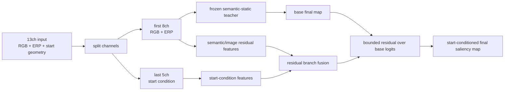

# JUFE Start-Conditioned Final-Map Protocol

更新时间：2026-07-10

> This is the **P1 conditioned oracle** defined by [RESEARCH_PROTOCOL.md](../RESEARCH_PROTOCOL.md). It is not the P0 image-only main task.

> **Historical protocol only:** Gate B previously used `jufe_start_conditioned_256x512_k6_order_groupdisjoint_v1`. All generated JUFE roots were removed on 2026-07-13 after the route was closed; rebuild only for explicit historical auditing.

## Purpose

JUFE startpoint is dataset-provided viewing-condition metadata, not a GT fixation sampled from the target scanpath. It can be used only in a separate conditioned protocol:

```text
ERP RGB image + ERP geometry + given startpoint metadata -> start-conditioned final saliency map
```

This protocol is not the same as the image-only Multi360 mainline. Results must be reported separately and compared with matched controls.

## Processed Data

Builder:

```bash
python scripts/prepare_jufe_start_conditioned.py
```

Output root:

```text
data/processed/jufe_start_conditioned_256x512_k6_order
```

Raw source is read only:

```text
${SCANDMM_ROOT}/data/raw/jufe
```

Each original JUFE image becomes two rows:

- `jufe_<source_id>__start_good`
- `jufe_<source_id>__start_bad`

The builder currently inherits the split from `data/processed/jufe_256x512_k6_order`, so good/bad versions of one exact source image stay together. The source split is not yet content-disjoint across distortion/quality variants and must be replaced before Gate B.

## Target Keys

Each target `.npz` stores numeric maps only:

- `final`, `temporal`, `cumulative`, `fixation`, `area_weights`
- `merged_final`, `merged_temporal`, `merged_cumulative`, `merged_fixation`
- `good_start_final`, `good_start_temporal`, `good_start_cumulative`, `good_start_fixation`
- `bad_start_final`, `bad_start_temporal`, `bad_start_cumulative`, `bad_start_fixation`

Condition metadata is stored in `manifest.jsonl`, not inside target `.npz`.

## Input Encoding

Dataset flag:

```yaml
train:
  condition_startpoint_channels: true
  startpoint_condition_mode: actual
  startpoint_prior_sigma_px: 10.0

model:
  in_channels: 13
```

Base image input has 8 channels:

```text
RGB + ERP geometry channels
```

Startpoint adds 5 relative-condition channels:

- `sin(delta_lon)`
- `cos(delta_lon)`
- relative latitude offset
- spherical proximity to startpoint
- ERP Gaussian start prior

Yaw-roll augmentation rolls image, GT maps, and startpoint-relative channels together.

Control mode:

```yaml
train:
  startpoint_condition_mode: swapped
```

`swapped` keeps the same condition-specific GT target but encodes the counterpart startpoint. This is the main control for whether the start-condition branch is using the correct start metadata.

## Current Model

Config:

```text
configs/jufe_start_conditioned_256x512.yaml
```

Batch configs:

```text
configs/batch_jufe_start_conditioned_smoke.yaml
configs/batch_jufe_start_conditioned_256.yaml
```

Model:

```text
start_conditioned_teacher_residual
```

Structure:



Important: the frozen static teacher only receives the first 8 image/ERP channels. Startpoint information cannot directly change the static trunk; it only conditions the supplement residual branch.

## Required Controls

For any claim that start/temporal information helps final-map prediction:

- Image-only semantic-static teacher on the same JUFE split.
- Start-conditioned teacher residual.
- Swapped-condition control: keep the condition-specific target fixed but encode the counterpart startpoint.
- Random-condition control with identical targets, model capacity, and training budget.
- Start-prior-only or no-image diagnostic only as support, not a main result.
- Per-condition test rows: good, bad, and combined.
- Optional merged-target report to connect back to image-only final-map saliency.

The offline evaluation summary now emits `condition:good` and `condition:bad` scopes when `manifest.jsonl` contains a `condition` field.

## Status

- Raw good/bad startpoint GT analysis is done: `reports/jufe_start_salmap_similarity/summary.md`.
- Clean group-disjoint manifest validation passed: 2064 rows, 1032 complete good/bad pairs, split 1440/312/312, 258 groups and 0 leaks.
- Dataset loader supports deterministic `actual`, `swapped`, and `random` inference conditions.
- Formal model is a frozen locked-static teacher plus a 10,098-parameter two-layer bounded residual head.
- Formal 3-seed Gate B report: `reports/gate_b_condition_signal/summary.md`.
- Gate B passed; P1 is frozen as mechanism evidence and remains separate from P0.

Legacy smoke retained for diagnosis:

| Run | Full-val `KLD_sph` | Read |
|---|---:|---|
| image-only semantic-static | `0.4248` | baseline sanity |
| start-conditioned residual, actual start | `0.2608` | residual branch helps |
| start-conditioned residual, swapped start | `0.2430` | swapped is better; start correctness is not proven |

Formal clean result: actual `KLD_sph=0.2488±0.0099`, static `0.3636`, swapped `0.4566`, random `0.4006`. Correct condition use is proven by same-checkpoint inference perturbations and grouped paired confidence intervals; contrastive loss was not needed.
